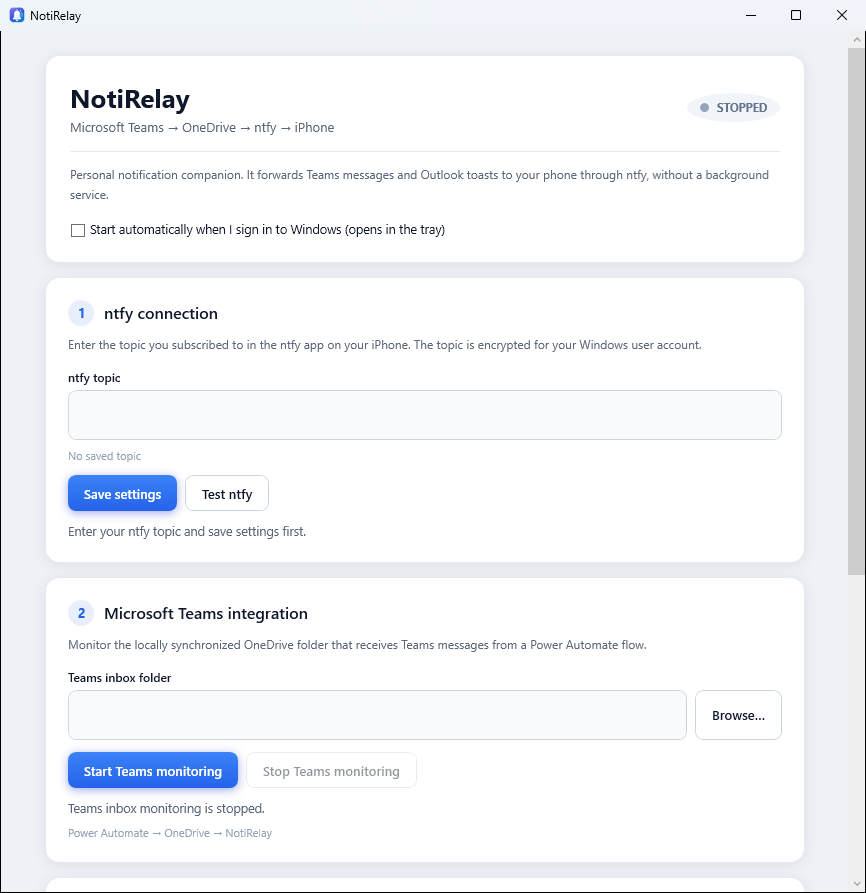
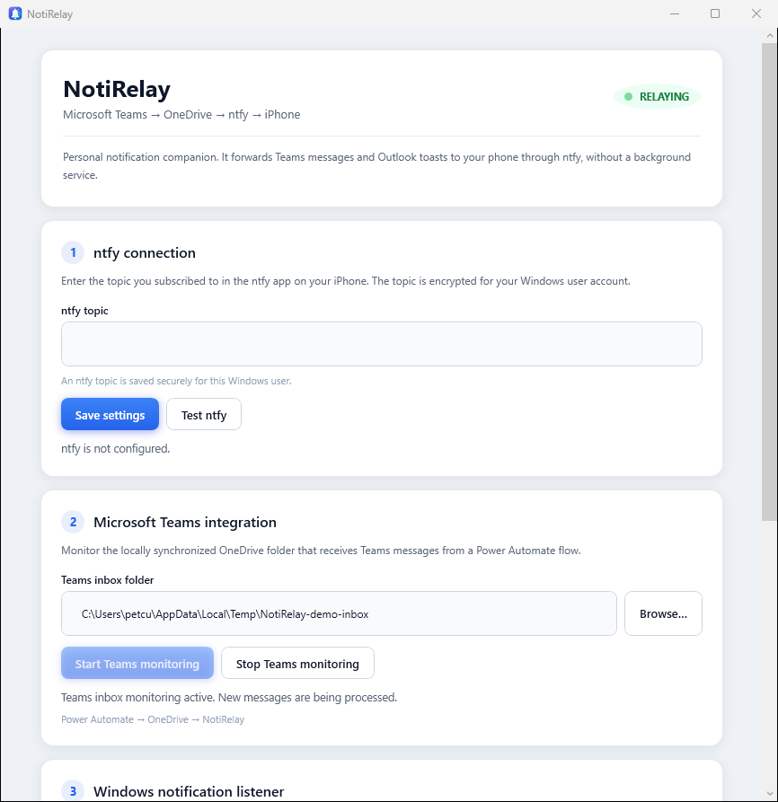
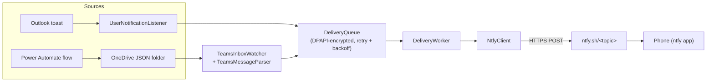

# NotiRelay

A small Windows desktop app that forwards selected desktop notifications to your phone through [ntfy](https://ntfy.sh), so you don't miss a message when you step away from the PC.

Built with WPF on .NET 10. Runs as a tray app, with no background service and no administrator rights.

> **Portfolio note:** published to show how it is built. It only forwards notifications to a destination you configure, after you explicitly confirm. Use any notification source and destination only where you are allowed to; it does not bypass IT, network, or application-control policies, and you should not use it to route another organization's data without permission.

## What it does

NotiRelay forwards two kinds of notifications to an ntfy topic over HTTPS:

- **Outlook desktop notifications** — read through the official Windows `UserNotificationListener` API.
- **Microsoft Teams messages** — read from a local OneDrive-synced folder of JSON files that a **Power Automate** flow exports there (Teams toasts often omit the full message body, so a flow is a reliable source).

You subscribe to the same topic in the ntfy app on your phone and receive the text as a push notification. Forwarding starts only after you confirm and press start.

## Features

- Forward Outlook toasts (Windows notification listener) and Teams messages (OneDrive inbox) to ntfy.
- **ntfy topic encrypted at rest** with Windows DPAPI for the current user.
- **Durable delivery queue** with automatic retry and backoff — queued items are persisted (DPAPI-encrypted) and survive a restart.
- **Baseline on start**: only notifications that appear after you press start are forwarded; existing ones are ignored.
- **System tray**, minimize-to-tray, and optional **Start with Windows** (per-user `HKCU\…\Run`, launches straight into the tray).
- Message bodies are not written to the local activity log.
- Single-file self-contained build, or a sparse-MSIX package for the notification-listener capability — both per-user, no admin.

## Screenshots

Idle and active (the header pill turns green and pulses while relaying):




## Architecture



| Area | Choice |
|---|---|
| Runtime / UI | .NET 10, WPF (+ WinForms tray icon), `net10.0-windows10.0.19041.0` |
| Notifications in | `Windows.UI.Notifications.Management.UserNotificationListener` |
| Teams in | OneDrive-synced JSON folder written by a Power Automate flow; HTML-stripped by a custom parser |
| Delivery | In-process worker + persistent queue with retry/backoff |
| Secrets at rest | Windows DPAPI (`ProtectedData`, CurrentUser) for the ntfy topic and the queue |
| Autostart | Per-user `HKCU\Software\Microsoft\Windows\CurrentVersion\Run` |
| Packaging | Self-contained single-file publish, or a signed sparse-identity MSIX (per-user, no admin) |

## Technical challenges

- **Notification-listener access for a Win32 app.** `UserNotificationListener` is normally gated behind package identity. The project uses Microsoft's supported **sparse identity package** (a tiny signed identity-only MSIX linked to the portable app folder via `Add-AppxPackage -ExternalLocation`), registered per-user with no admin, no service, no scheduled task.
- **Reliable delivery.** A notification shouldn't be lost if the network blips. Deliveries go through a persisted queue; `DeliveryWorker` retries with backoff and tracks attempt counts, and the queue is DPAPI-encrypted on disk.
- **Teams message bodies.** Teams toasts frequently don't carry the full text, so the app reads messages from a Power Automate → OneDrive JSON "dead drop" — which also avoids Microsoft Graph admin consent and any public webhook endpoint.
- **Secrets at rest.** The ntfy topic and queued payloads are protected with DPAPI for the current Windows user, never stored in clear text.
- **Portability.** Ships either as one self-contained `.exe` (double-click) or as a per-user sparse package, so it runs on another PC without installing a runtime or needing admin rights.

## Build and run

Requires the .NET 10 SDK on a Windows 10/11 x64 machine.

```powershell
dotnet run --project src
```

Single-file self-contained executable:

```powershell
dotnet publish src -c Release -r win-x64 --self-contained true `
  -p:PublishSingleFile=true -p:IncludeNativeLibrariesForSelfExtract=true `
  -p:EnableCompressionInSingleFile=true -o out\single
```

Sparse-identity package for the notification listener (per-user, no admin): run `build-package.ps1`, copy the resulting `out\deploy` folder to the target PC, then `install-current-user.ps1`. The private signing key never leaves the build machine. See the packaging scripts for details.

### ntfy setup

1. Pick a long, unguessable topic (anyone who knows it can read what is posted to it) and subscribe to it in the ntfy app, or at `https://ntfy.sh/<topic>`.
2. Enter the topic in the app and press **Save settings** (stored DPAPI-encrypted in `%LOCALAPPDATA%\NotiRelay`).
3. Press **Test ntfy**, then tick the confirmation and press **Start monitoring**.

## Notes

- Code comments reference an internal design document that is not part of this repository.
- One user-facing test string is in Romanian; everything else is in English.

---

Portfolio project, not open source. © 2026 Petcu Iulian. All rights reserved. See [LICENSE](LICENSE).
