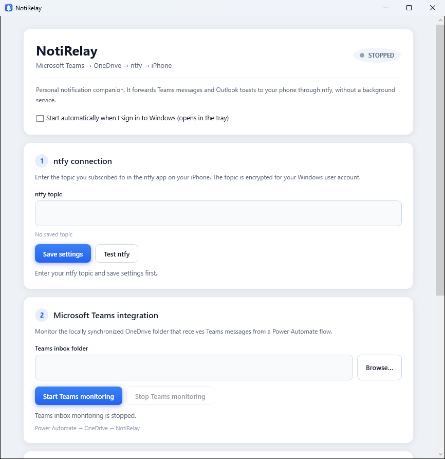
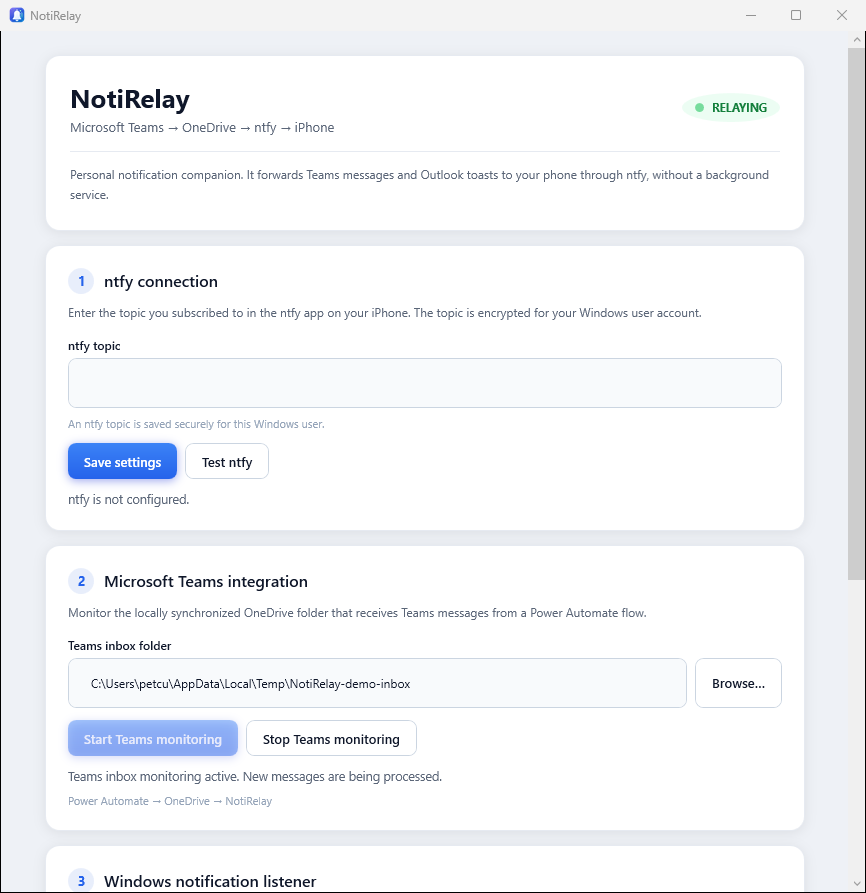
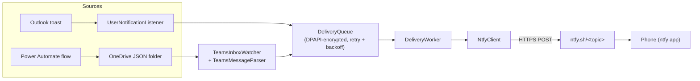

# NotiRelay

A small Windows desktop app that forwards selected desktop notifications to your phone through [ntfy](https://ntfy.sh), so you don't miss a message when you step away from the PC.

Built with WPF on .NET 10. Runs as a tray app, with no background service and no administrator rights.

> **Portfolio note:** published to show how it is built. It only forwards notifications to a destination you configure, after you explicitly confirm. Use any notification source and destination only where you are allowed to; it does not bypass IT, network, or application-control policies, and you should not use it to route another organization's data without permission.

## What it does

NotiRelay forwards two kinds of notifications to an ntfy topic over HTTPS:

- **Outlook desktop notifications** — read through the official Windows `UserNotificationListener` API.
- **Microsoft Teams messages** — read from a local OneDrive-synced folder of JSON files that a **Power Automate** flow exports there (Teams toasts often omit the full message body, so a flow is a reliable source).

You subscribe to the same topic in the ntfy app on your phone and receive the text as a push notification. Forwarding starts only after you confirm and press start.

## Features

- Forward Outlook toasts (Windows notification listener) and Teams messages (OneDrive inbox) to ntfy.
- **ntfy topic encrypted at rest** with Windows DPAPI for the current user; validated before saving, written atomically, with a warning for short, guessable topics.
- **Durable delivery queue** with automatic retry and backoff — queued items are persisted (DPAPI-encrypted) and survive a restart.
- **Nothing old is sent without asking**: at launch, if notifications are still waiting from before (unsent queue items) or Teams messages / Outlook notifications arrived while the app was closed, a warning asks *"Do you want me to send the messages that you missed while the app was closed?"* before anything is sent. **Yes, send them** sends everything oldest first (missed ones marked `Missed ·`); **No, start from now** deletes the old ones and relays only new messages.
- **Outlook calendar** (classic Outlook, while it is open): new, moved or cancelled meetings in the next 7 days reach the phone within about 15 seconds, today's agenda arrives at 08:45, and a reminder 10 minutes before each meeting. Meeting bodies are never read and nothing is copied into another calendar; the activity log shows no meeting titles.
- **Power & battery**: optional low-battery alerts when the laptop drops to 30% and to 10% while not charging (read from Windows itself, checked every 30 s).
- **Topic per notification type**: Teams messages, Outlook notifications, Meetings and Power & battery can each go to their own ntfy topic (empty = main topic), stored encrypted; Send test sends one test per topic in use.
- **Stop sending** button (header and tray menu): nothing more goes to ntfy, including notifications already queued. **Resume sending** asks whether to send or discard what was collected meanwhile. Stop Teams / Stop Outlook only stop capturing.
- **Respects ntfy rate limits**: on HTTP 429 it sends one notification every 5 s (longer while ntfy keeps refusing) and keeps the order, with one log line instead of one per message.
- **Baseline on first start**: on the very first run, existing inbox files and toasts are ignored.
- **System tray**, minimize-to-tray, and optional **Start with Windows** (per-user `HKCU\…\Run`, launches straight into the tray).
- Message bodies are not written to the local activity log.
- **Debugging** button (Activity log): writes everything to `NotiRelay-debug.log` next to the exe (or `%LOCALAPPDATA%\NotiRelay` if that folder is read-only): the activity log with milliseconds, full error details, and a read-only network check for ntfy.sh (proxy, DNS, port 443, HTTPS health). The topic is masked, message text is never written, it stays on across restarts until turned off, and it is capped at 2 × 5 MB.
- Single-file self-contained build, or a sparse-MSIX package for the notification-listener capability — both per-user, no admin.

## Screenshots

Idle and active (the header pill turns green, pulses and names the active sources while relaying):




## Architecture



| Area | Choice |
|---|---|
| Runtime / UI | .NET 10, WPF (+ WinForms tray icon), `net10.0-windows10.0.19041.0` |
| Notifications in | `Windows.UI.Notifications.Management.UserNotificationListener` |
| Teams in | OneDrive-synced JSON folder written by a Power Automate flow; HTML-stripped by a custom parser |
| Delivery | In-process worker + persistent queue with retry/backoff |
| Secrets at rest | Windows DPAPI (`ProtectedData`, CurrentUser) for the ntfy topic and the queue |
| Autostart | Per-user `HKCU\Software\Microsoft\Windows\CurrentVersion\Run` |
| Packaging | Self-contained single-file publish, or a signed sparse-identity MSIX (per-user, no admin) |

## Technical challenges

- **Notification-listener access for a Win32 app.** `UserNotificationListener` is normally gated behind package identity. The project uses Microsoft's supported **sparse identity package** (a tiny signed identity-only MSIX linked to the portable app folder via `Add-AppxPackage -ExternalLocation`), registered per-user with no admin, no service, no scheduled task.
- **Reliable delivery.** A notification shouldn't be lost if the network blips. Deliveries go through a persisted queue; `DeliveryWorker` retries with backoff and tracks attempt counts, and the queue is DPAPI-encrypted on disk.
- **Teams message bodies.** Teams toasts frequently don't carry the full text, so the app reads messages from a Power Automate → OneDrive JSON "dead drop" — which also avoids Microsoft Graph admin consent and any public webhook endpoint.
- **Secrets at rest.** The ntfy topic and queued payloads are protected with DPAPI for the current Windows user, never stored in clear text.
- **Portability.** Ships either as one self-contained `.exe` (double-click) or as a per-user sparse package, so it runs on another PC without installing a runtime or needing admin rights.

## Download

Get `NotiRelay-<version>.exe` from the [Releases](https://github.com/iulian880/NotiRelay/releases) page. It is a self-contained single file: copy it to any Windows 10/11 x64 PC and run it, with no .NET install and no administrator rights. Every push to `main` rebuilds it on Windows (GitHub Actions) and updates the release; every pull request gets a test build under the workflow run's **Artifacts**.

## Build and run

Requires the .NET 10 SDK on a Windows 10/11 x64 machine.

```powershell
dotnet run --project src
```

Single-file self-contained executable:

```powershell
dotnet publish src -c Release -r win-x64 --self-contained true `
  -p:PublishSingleFile=true -p:IncludeNativeLibrariesForSelfExtract=true `
  -p:EnableCompressionInSingleFile=true -o out\single
```

Sparse-identity package for the notification listener (per-user, no admin): run `build-package.ps1`, copy the resulting `out\deploy` folder to the target PC, then `install-current-user.ps1`. The private signing key never leaves the build machine. See the packaging scripts for details.

### ntfy setup

1. Pick a long, unguessable topic (anyone who knows it can read what is posted to it) and subscribe to it in the ntfy app, or at `https://ntfy.sh/<topic>`.
2. Paste the topic (or its `https://ntfy.sh/<topic>` link) into the app and press **Save topic** or Enter. It is validated first, so a bad value never replaces the saved one, then stored DPAPI-encrypted in `%LOCALAPPDATA%\NotiRelay`. The window confirms it with the last four characters (`✓ Saved: ••••9q2x`).
3. Press **Send test**. For Outlook, tick the confirmation once (it is remembered) and press **Start Outlook monitoring**.

### Troubleshooting

If notifications stop reaching your phone, press **Debugging** in the Activity log, wait a minute (or restart the app so startup is captured), then press **Show file** and send `NotiRelay-debug.log`. The on-screen log also shows a one-line *Network check* result. Press **Debugging ON** again to stop.

## Notes

- Code comments reference an internal design document that is not part of this repository.
- One user-facing test string is in Romanian; everything else is in English.

---

Portfolio project, not open source. © 2026 Petcu Iulian. All rights reserved. See [LICENSE](LICENSE).
